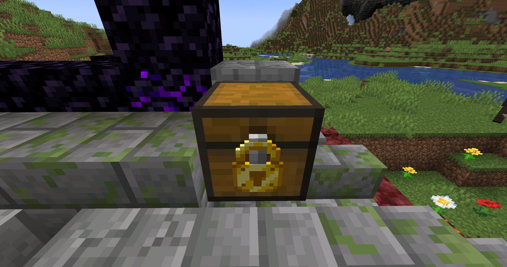
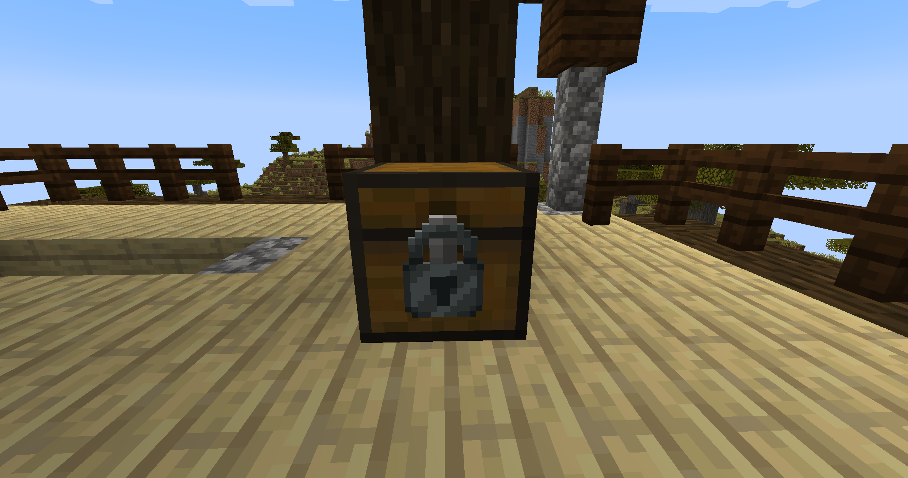

<p align="center"></p>

# Locks Neoforked

**Attach a real lock to anything you build — then watch someone try to pick it.**

Locks Neoforked is a modernized spin on the origianl [Locks](https://minecraft.curseforge.com/projects/locks) mod by [Melonslise](https://github.com/Melonslise). Now you can Lock not just chest: doors,
trapdoors, furnaces, dispensers, hoppers, barrels, and everything your other mods add.

An unofficial port of the original [Locks](https://minecraft.curseforge.com/projects/locks) by
[Melonslise](https://github.com/Melonslise), for Minecraft **1.21.1** on **NeoForge**.

<p align="center"></p>

---

## Why play it

- **Locks anything, from any mod.** One spatial lock secures a whole double chest, a doorway, or a bank of
  industrial machinery. It does not care what mod added the block.
- **A real minigame, not a timer.** Each lock has a pin combination. Every wrong pin costs your lock pick
  durability, and how much depends on the lock you are attacking. You can watch the bar and count your mistakes.
- **It finds you.** Locked chests generate naturally throughout the Overworld, the Nether and the End — and the
  tier you get tracks how rich the chest was, so a village crate and an ancient-city vault never feel the same.
- **Keys, rings and a master key.** Cut a copy before you place the lock, carry a whole ring of them, or keep the
  master key for yourself.
- **Real defence, not just a texture.** Locked blocks resist explosions, pistons, hoppers and redstone, and locked
  doors stay shut against villagers and any modded NPC that tries to open them.
- **Yours to shape.** Twelve enchantments split between locks and picks, so you can fortify your chest or weaken
  the thieves. Everything is data-driven: add your own tiers, or retune the existing ones, without touching code.

## Getting the tiers

Seven lock tiers — **wood, copper, iron, gold-plated, diamond-plated, netherite**, plus a **steel** tier for
packs with a steel provider — each with its own pin count, enchantability, blast resistance and pick-wear. Lock
picks mirror them. Nothing is locked behind progression: netherite gear is fire-resistant and smithed from its
diamond equivalent, exactly like vanilla.

<p align="center"></p>

**Netherite locks are an End-exclusive find.** They are the reward for surviving a run to an end city and appear
nowhere else. Everywhere else, a chest rich enough for netherite drops to diamond instead of going bare — so the
best lock in the game stays something you go and take.

**Steel comes from your pack, not from us.** Locks ships no steel material at all: no ingot, no nugget, no ore, no
ore generation. Steel from Create, Immersive Engineering, Mekanism, Thermal — anything that tags its steel into
`c:ingots/steel` — works in every Locks recipe. It is a craft-only tier, it gates nothing, and if your pack has
no steel the recipes are simply absent rather than broken.

---

<details>
<summary>All seven lock tiers, exact stats</summary>

| Lock | Pins | Enchantability | Resistance | Pick Wear |
|------|------|----------------|------------|-----------|
| Wood | 5 | 15 | 4 | 1 |
| Copper | 6 | 16 | 8 | 2 |
| Gold Plated | 6 | 22 | 6 | 2 |
| Iron | 7 | 14 | 12 | 3 |
| Steel | 9 | 12 | 20 | 6 |
| Diamond Plated | 11 | 10 | 100 | 12 |
| Netherite | 14 | 8 | 200 | 24 |

- **Pins** — number of pins in the minigame; more pins means harder to pick.
- **Enchantability** — how readily the lock takes powerful enchantments.
- **Resistance** — explosion resistance. Diamond and netherite are virtually indestructible.
- **Pick Wear** — durability this lock takes off a pick on every wrong pin. This is what makes tier a real
  economic defence: a wood pick taken to a netherite lock ends on a single mistake.

The **steel lock is an outsider** by design — it is the only tier that needs another mod's material, so it gates
nothing else (the gold and diamond-plated locks are built on the *iron* mechanism) and it never spawns on a
generated chest. Treat it as a flavour tier for your pack rather than a step in the ladder.

</details>

<details>
<summary>All seven lock pick tiers, exact stats</summary>

| Lock Pick | Strength | Enchantability | Durability | Wrong pins vs. its own tier |
|-----------|----------|----------------|------------|------------------------------|
| Wood | 0.20 | 5 | 32 | 32 |
| Bobby Pin (copper) | 0.28 | 7 | 48 | 24 |
| Gold | 0.25 | 22 | 40 | 20 |
| Iron | 0.35 | 10 | 96 | 32 |
| Steel | 0.70 | 12 | 192 | 32 |
| Diamond | 0.85 | 10 | 384 | 32 |
| Netherite | 0.95 | 15 | 768 | 32 |

- **Strength** — which locks the pick may attempt at all (the Complexity gate). It does *not* affect wear.
- **Enchantability** — how well the pick takes enchantments at the enchanting table. The gold pick is the
  "enchant me" tier, exactly like vanilla gold gear.
- **Durability** — points before the pick breaks. The shipped values give a pick roughly **32 mistakes against a
  lock of its own tier**.
- Picks are proper tools, so **Mending, Unbreaking and anvils** all work, and every tier is repairable.

**Picks stack to 64.** Minecraft normally makes a durable item unstackable; Locks restores the full stack size
and only ever wears down *one* pick at a time. The first wrong pin that actually costs durability splits the stack:
the pick in your hand takes the damage, the untouched remainder returns to your inventory. A worn pick will not
merge back into a fresh stack until repaired, and an anvil refuses to apply an enchanted book to a stack of more
than one, so a single book cannot enchant 64 picks at once.

Netherite locks and picks are **fire-resistant** and survive lava. Both are smithed from their diamond equivalent
using a Netherite Upgrade Template.

</details>

<details>
<summary>Lock picking in detail</summary>

A chest with a lock on it does not simply refuse to open. Right-click it with a lock pick and you get the
pin-matching minigame: work the pins until you find the combination.

**A wrong pin costs durability, decided by the lock.** There is no dice roll on whether your pick survives. The
lock you are attacking sets how much each mistake costs, and the pick breaks only when its durability runs out.
A guess that is off by exactly one pin costs about a third as much as a wild miss, but never less than 1 — so no
combination of enchantments and config values makes picking free. You can watch the durability bar and know
exactly how many mistakes you have left before the worst happens.

**Tooltips tell you the truth.** Each lock carries its own id and combination, generated so it cannot be
derived from public data, and the HUD and tooltip can be configured to show as much or as little of it as you
like.

*Optional:* enable **Allow Itemless Lock Picking** and players can play the same minigame with an empty hand, no
pick required. Itemless attempts never consume or damage anything and are never blocked by Complexity, but a
wrong pin drops every pin you had already solved. Off by default; physical picks behave exactly as before either
way.

</details>

<details>
<summary>Keys, key rings and the master key</summary>

A **Key Blank** is uncut — it opens nothing until you pair it with a lock, and you pair it *before* placing the
lock:

1. Craft a **Key Blank**.
2. Before placing the lock, put one blank and the lock together in any crafting grid — your 2×2 inventory grid
   works, and so does a crafting table.
3. The recipe hands back the lock and produces a **Key** that matches it.
4. Place the lock. That key now unlocks and re-locks it.
5. Craft the paired key with another blank to cut a spare.

The recipe is shapeless and one blank makes one key.

**A blank cannot copy a lock that is already placed.** That is deliberate: if holding a blank against a placed
lock cut a matching key, any visitor could manufacture one and your lock would protect nothing. Right-clicking a
placed lock with a blank just reminds you of the workflow. If you placed a lock before pairing it, sneak with an
empty hand to take the unlocked lock back, pair it, and place it again.

- A **Key Ring** holds many keys at once and opens any lock whose key is inside. With Curios installed it works
  straight from a curio slot, without occupying your hand.
- A **Master Key** opens any lock, regardless of id.
- The **Awareness** enchantment binds a lock to whoever placed it: the block opens for them normally while staying
  locked to everyone else. Sneak and right-click with an empty hand to act on the lock itself.

</details>

<details>
<summary>All twelve enchantments</summary>

**Lock enchantments** — go on the lock:

| Enchantment | Max Level | Effect |
|-------------|-----------|--------|
| **Shocking** | V | Electrocutes players who fail a pick attempt (bypasses armor) |
| **Sturdy** | III | Makes every wrong pin cost the pick more durability (+50% per level by default) |
| **Complexity** | III | Blocks lower-tier picks from attempting the lock at all |
| **Silent** | I | Suppresses the rattle sound when access is denied. Incompatible with Shocking |
| **Auto-Pick** | III | 10%/20%/30% chance to instantly open the lock, bypassing the minigame. Incompatible with Complexity |
| **Reinforced** | III | Increases explosion resistance by 50%/100%/150% |
| **Awareness** | I | The lock does not apply to whoever placed it. Sneak + right-click with an empty hand to act on the lock itself |

**Lock pick enchantments** — go on the pick, and provide counterplay:

| Enchantment | Max Level | Effect |
|-------------|-----------|--------|
| **Finesse** | III | Reduces the durability a wrong pin costs, 15% per level (counters Sturdy). Incompatible with Last Catch |
| **Attunement** | II | Boosts effective pick strength against complex locks (counters Complexity) |
| **Grounded** | III | Reduces damage from Shocking locks while holding the pick, in either hand (counters Shocking) |
| **Quiet Hand** | I | Reduces the sound of failed pin attempts |
| **Last Catch** | I | ~20% chance that a wrong pin costs no durability at all. Incompatible with Finesse |

Each of the twelve can be individually disabled, and the pick-side effects tuned, in the server config.

</details>

<details>
<summary>What a lock actually protects</summary>

A locked door cannot be opened by villagers or any other door-opening AI — including modded NPCs that drive a
vanilla or subclassed door. Closing a locked door is still allowed; only opening is refused, and re-locking an
open door closes it, so a door can never stand open while its lock reports locked.

Locked blocks are also protected from:

- Redstone activation
- Hopper extraction
- Piston movement
- Explosions
- Breaking (configurable)

</details>

<details>
<summary>How locked chests are generated</summary>

- Locked chests spawn naturally in structures across the **Overworld, the Nether and the End**, as well as in
  modded dimensions whose biomes join the relevant vanilla tags.
- **Roughly 3 in 10 chests are left bare by default.** Finding a locked chest should be an event, not a given.
  Raise **Chest Lock Chance** toward 1.0 to seal every chest, or drop it to leave more of them empty.
- **Tier follows the chest's loot value.** The value is computed deterministically by reading the loot table's
  own JSON — pools, rolls, weights, nested references and tag entries — so the same chest always scores the same.
  Item value scales with the square root of stack size, so 64 cobblestone does not outrank a diamond sword, and
  rarity and loot-table enchantment functions push an item up a band. Overridable per item in the config.
- **Reaching a tier makes it possible, not certain.** A chest that qualifies for diamond still rolls for diamond
  and steps down a tier on a failure, so rich chests come out varied instead of uniform. The per-tier chances are
  configurable.
- Two independent reasons a chest ends up bare: its loot value falls below the lowest threshold, or it lost the
  30% roll above. Either can be tuned separately.
- Locks, keys and mechanisms are injected into chest loot tables (configurable by pattern,
  `minecraft:chests/` by default).
- Villagers of a configurable profession (toolsmith by default) sell picks and mechanisms — and, as an opt-in,
  early-game wood, copper and iron locks. Wandering traders offer gold picks plus rare enchanted diamond and
  netherite locks. Every trade category toggles independently. **No steel is ever traded.**

The **End-only netherite tier** is controlled by two datapack tags: `locks:biome_gated_locks` names the
restricted locks and ships with `locks:netherite_lock`, `locks:biome_gated_lock_biomes` names the biomes they may
appear in and ships with `#minecraft:is_end`. Clear or extend either to move a tier into other dimensions; a
`/reload` is enough.

</details>

<details>
<summary>Configuration</summary>

All settings are config-driven. Note that `locks-server.toml` is **per-world** and lives in a different location
than the other two.

**`config/locks-common.toml`** — world generation and item stats

- **Chest Lock Chance** — chance (0.0–1.0) that an eligible generated chest receives a lock **at all**
  (default 0.7, so roughly 3 in 10 stay bare)
- **Generation Enchant Chance** — how often generated locks are enchanted (default 40%)
- **Generated Locks / Generated Lock Chances** — which tiers appear in worldgen and their relative weights (used
  when loot scaling is off; also the tier order for `Loot Value Tiers`)
- **Loot-Scaled Locks** — lock tier based on chest loot value (on by default), with `Default Item Value`, the
  rarity multipliers, `Enchantment Value Bonus`, `Item Value Overrides`, the per-tier `Loot Value Tiers`
  thresholds (default `[2.0, 5.0, 9.0, 13.0, 20.0, 21.0]`) and **`Lock Tier Chances`** (default
  `[1.0, 0.85, 0.7, 0.55, 0.35, 0.5]`), the per-tier keep-chance that makes a qualifying tier a roll rather
  than a guarantee
- **Randomize Loaded Locks** — whether to randomise combinations loaded from structure files (default false)
- **Lock Stats / Lockpick Stats** — per-tier stat overrides (see the section above)

The shipped tiers were placed against vanilla 1.21.1's measured chest-loot distribution rather than by guesswork.
A modpack that inflates item values pushes every chest up the ladder, so re-space them if you also touch
`Default Item Value`, the rarity multipliers or `Item Value Overrides`. A threshold above the p90 is effectively
unreachable — and the netherite value has to stay at or below ~22, because the end city chest (worth 22.2) is the
only End chest table in the game and netherite is End-gated.

**`saves/<world>/serverconfig/locks-server.toml`** — server-side gameplay rules (generated per-world on first load)

- **Lockable Blocks / Lockable Tags** — regex patterns and block tags for what can be locked (default: chests,
  barrels, hoppers, doors, trapdoors, fence gates, shulker boxes)
- **Max Lockable Volume** — maximum blocks a single lock can cover (default 6)
- **Allow Removing Locks / Protect Lockables / Easy Lock** — sneaking unlocked locks off, survival break-proofing,
  one-click placement
- **Display** — hide lock id, HUD enchantments, HUD tooltip
- **Enchantments** — individually enable or disable each of the twelve, with a `Lock Pick` subsection tuning
  Finesse, Attunement, Sturdy, Near Miss, Grounded, Last Catch and Quiet Hand
- **Enchantments.Shocking** — damage formula, cooldown, whether an enchantment is required at all, and four
  independent triggers (pick break, wrong pin, unauthorized interaction, block break attempt). Creative players
  are exempt
- **Netherite Lockpick Unbreakable** — never break netherite picks (default false)
- **Allow Itemless Lock Picking** — play the minigame with an empty hand (default false)
- **Loot Table Injection Patterns** — which loot tables receive pick and key injection (default
  `minecraft:chests/`)
- **Trades** — master and per-category switches for villager and wandering trader sales, plus `Villager
  Profession` (default `minecraft:toolsmith`). Villager *lock* sales are opt-in; no category covers steel
- **Compatibility.CarryOn** — whether the integration is active, whether locked blocks may be carried, whether
  carrying requires authorization, whether partial multi-block pickups are denied, and transfer logging

**`config/locks-client.toml`** — client-side settings

- **Deaf Mode** — visual feedback for lock picking accessibility (default true)

**Stale config files:** when the mod is updated with new tiers, existing TOML files keep their old defaults — for
example a `Generated Locks` list written before a tier existed will not contain it. Add the entry yourself, or
delete `locks-common.toml` and let it regenerate. This is also why behaviour that must hold regardless of an
existing config is enforced in code: the steel lock is hard-gated by the `locks:steel_provider_locks` item tag
while `c:ingots/steel` is empty, so a stale config cannot put it back into your world.

</details>

<details>
<summary>Adding custom locks &amp; lock picks</summary>

Locks Reforged has a fully data-driven item system. You can add entirely new lock and lock pick tiers — or tweak
existing ones — using three different methods depending on your needs.

### Method 1: Config Folder (New Custom Items)

Drop a JSON file into the config folder to register a brand new lock or lock pick item. The mod auto-discovers
these at startup.

**To add a custom lock**, create `config/locks/lock_types/<name>.json`:

```json
{
  "length": 7,
  "enchantment_value": 14,
  "resistance": 12,
  "pick_wear": 3,
  "fire_resistant": false
}
```

- `length` — number of pins (1–20)
- `enchantment_value` — enchantability (1–50)
- `resistance` — explosion resistance (0–1000)
- `pick_wear` — lock pick durability a wrong pin costs on this lock (1–1000, optional, default 1)
- `fire_resistant` — whether the item survives fire and lava (optional, default false)

**To add a custom lock pick**, create `config/locks/lockpick_types/<name>.json`:

```json
{
  "strength": 0.5,
  "enchantment_value": 10,
  "durability": 96,
  "fire_resistant": false
}
```

- `strength` — which locks the pick may attempt, the Complexity gate (0.01–10.0). Does not affect wear
- `enchantment_value` — enchantability at the enchanting table (0–50, optional, default 0 = not table-enchantable)
- `durability` — durability points before the pick breaks (0–10000, optional, default 64). **0 makes it
  unbreakable** — the escape hatch for packs that want the old "picks never break" feel
- `fire_resistant` — whether the item survives fire and lava (optional, default false)

The filename becomes the item's registry name under the `locks:` namespace (e.g. `netherite_lock.json` registers
as `locks:netherite_lock`). Config-folder items override JAR-bundled items of the same name, so you can also use
this to replace built-in stats.

**Important:** custom items registered this way appear in-game automatically, but are invisible and uncraftable
without:

- A **resource pack** providing a model and texture (`assets/locks/models/item/<name>.json`,
  `assets/locks/textures/item/<name>.png`), and optionally a lock picking screen texture
  (`assets/locks/textures/lockpicking/<name>.png`, which falls back to the iron lock's)
- A **datapack** providing a crafting recipe (`data/locks/recipe/<name>.json`) and adding the item to the
  appropriate tag (`data/locks/tags/item/locks.json` or `lock_picks.json`)

The mod creates example files at `config/locks/lock_types/_example.json.disabled` and
`config/locks/lockpick_types/_example.json.disabled` on first launch for reference.

### Method 2: Datapack Stat Overrides (Tweak Existing Items Per-World)

Datapacks can override the stats of any existing lock or lock pick on a per-world basis. Overrides are applied on
world load and whenever `/reload` is run, making them ideal for modpack authors or adventure maps.

**To override lock stats**, place a JSON file at `data/<namespace>/locks/lock_stat_overrides/<name>.json`:

```json
{
  "item": "locks:iron_lock",
  "length": 3,
  "resistance": 50
}
```

**To override lock pick stats**, place a JSON file at
`data/<namespace>/locks/lockpick_stat_overrides/<name>.json`:

```json
{
  "item": "locks:iron_lock_pick",
  "strength": 1.5
}
```

Only the fields you list are changed — omitted fields keep their current values. Multiple datapacks can provide
overrides; they stack in datapack load order.

A lock's `pick_wear` **can** be overridden here, because it is read fresh on every wrong pin. A lock pick's
`durability` **cannot** — it is baked into the item when it is registered at startup, long before any datapack
loads, and a `durability` key here is ignored with a warning in the log.

### Method 3: TOML Config (Override Stats Without Datapacks)

Every built-in lock and lock pick has TOML config entries in `locks-common.toml` that let you override individual
stats without needing a datapack. Set any value to `-1` (or `-1.0` for pick strength) to use the JSON default.
Each lock also has a `Pick Wear` entry. Pick **durability** is the one stat that cannot be set here or by
datapack — set it in `config/locks/lockpick_types/<name>.json`.

```toml
# Example: make the copper lock have 8 pins instead of 6
["Lock Stats"."Copper Lock"]
    Length = 8
    "Enchantment Value" = -1
    Resistance = -1
    "Pick Wear" = -1

# Example: double the copper pick strength
["Lockpick Stats"]
    "Copper Lockpick Strength" = 0.56
```

TOML overrides are applied before datapack overrides, so datapacks take final precedence.

### Override Priority

When multiple systems provide values for the same stat, the order of precedence is:

1. **Datapack stat overrides** (highest priority, applied on `/reload`)
2. **TOML config overrides** (applied on config load)
3. **Config folder JSON** (overrides JAR defaults at startup)
4. **JAR-bundled JSON** (lowest priority, built into the mod)

### A Note on Mechanisms

Lock mechanisms (Wood, Copper, Iron, Steel) are basic crafting components — they are not data-driven and cannot be
added via config or datapack. Each lock recipe requires a mechanism as the centre ingredient: the Wood and Copper
locks use their own, Iron and Steel use theirs, and the Gold and Diamond Plated locks build on the **iron**
mechanism (the Netherite lock is smithed from the Diamond one).

</details>

<details>
<summary>Mod compatibility</summary>

- **Curios** *(optional)* — the Key Ring works from a curio slot without occupying your hand.
- **Carry On** *(optional)* — locks travel with a block you pick up and carry. Configurable: whether locked
  blocks may be carried at all, whether carrying one requires authorization, and whether picking up part of a
  multi-block lock is refused.
- **Respawning Structures** *(optional)* — respawned chests get re-locked.
- **Lootr** *(optional)* — each half of a double chest is treated as an independent lockable, matching how Lootr
  splits them.
- **C2ME and other async-chunk mods** — chunk lockable data is parsed off-thread safely and handed to the world
  on the main thread, so async chunk loading does not deadlock or drop locks.

</details>

---

## Requirements

- Minecraft **1.21.1**
- NeoForge **21.1.216** or later
- Java **21**

Optional: **Curios** (9.x API) and **Carry On** (2.2.2+ for NeoForge 1.21.1). Neither is required.

**Multiplayer note:** client and server must run the same version — the lock picking network protocol is
version-checked at the handshake, and a mismatched connection is refused cleanly rather than misbehaving later.

---

## Credits

- **Original Author:** [Melonslise](https://github.com/Melonslise)
- **Original Mod:** [Locks on CurseForge](https://minecraft.curseforge.com/projects/locks)
- **Textures:** Hoonts, Artsy (ydgy)
- **Sounds:** [freesound.org](https://freesound.org)

This is an unofficial port that preserves all original gameplay. Licensed under **CC BY-NC 3.0**, consistent with
the original mod.